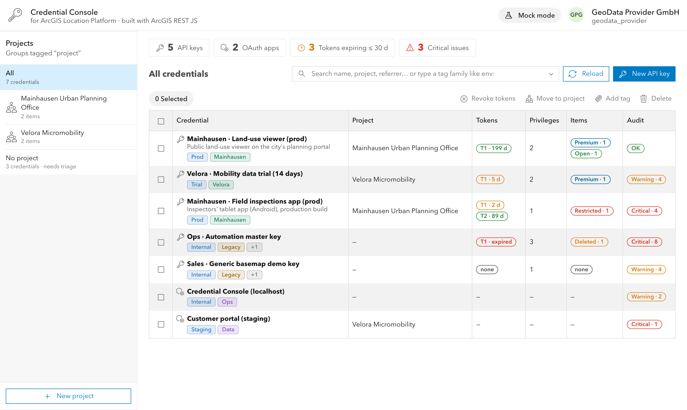
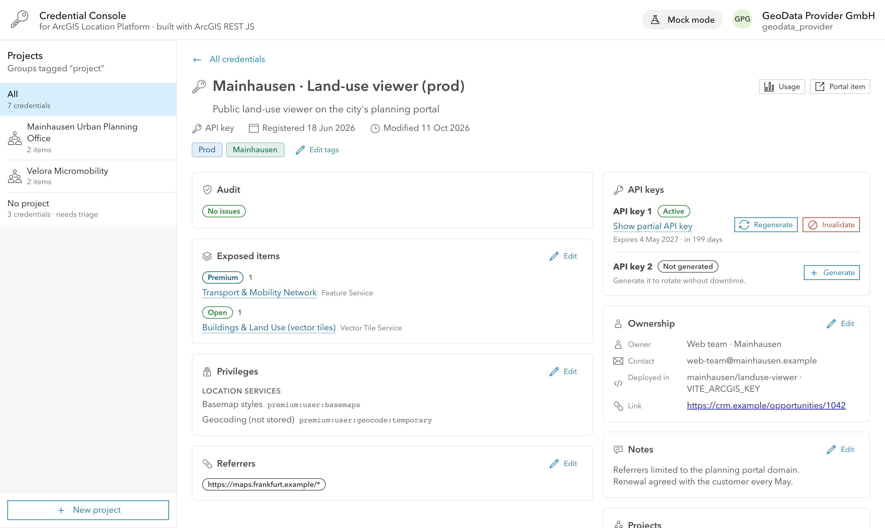

# Credential Console for ArcGIS Location Platform

**A developer credentials dashboard built with [ArcGIS REST JS](https://developers.arcgis.com/arcgis-rest-js/).**
Audit, rotate and revoke API keys and OAuth apps, see what data each one exposes, and organize them by customer, with an owner to call when something expires.

**[Try the live demo with fictional data →](https://hhkaos.github.io/arcgis-credential-console/?mock)** · or [sign in with your ArcGIS Location Platform account](https://hhkaos.github.io/arcgis-credential-console/)



## Why this exists

In ArcGIS you manage each developer credential from its item page, and the ArcGIS Location Platform dashboard shows how each one is used. When you look after dozens of API keys for different customers, you may also want a view organized around your own workflow, one that answers questions such as:

- Which keys expire this month, and who should I call?
- What data does each key expose? Does any key expose restricted data without referrers?
- Which keys belong to which customer?
- How do I rotate a key without downtime?
- Which keys have admin privileges or access to every item?

Because ArcGIS exposes all of this through its REST APIs, you can build that view yourself. Credential Console is one example, for a typical scenario: a **data provider** that hosts its layers on ArcGIS Location Platform and gives its customers access through API keys scoped to specific items. It complements the ArcGIS apps; it doesn't replace them.

It was built as the sample app for the session **Working with ArcGIS REST JS** at the Esri Developer Summit Europe 2026. Talk materials: [EsriDevEvents/working-with-arcgis-rest-js-dtseu-2026](https://github.com/EsriDevEvents/working-with-arcgis-rest-js-dtseu-2026).

## Project status

> [!IMPORTANT]
> **This is an illustrative sample, not production-ready as is.** It is unofficial, not an Esri product and not supported by Esri. It has no backend, keeps the user session in the browser's `localStorage`, has no automated tests, and loads every credential at once.

There are **no plans to keep developing it**. If you would like to use it, adapt it or contribute, please [open an issue](https://github.com/hhkaos/arcgis-credential-console/issues) and let's talk.

## Features

- **Overview:** clickable KPIs (API keys, OAuth apps, tokens expiring soon, critical issues) and a search that mixes free text with tag filters.
- **Audit:** rules for expired or expiring tokens, missing referrers, admin or global-access privileges, restricted data exposed without referrers, deleted items, credentials without project or owner.
- **API key lifecycle:** per-slot Generate / Regenerate / Invalidate (zero-downtime rotation), partial API key, and in-place editing of items, privileges and referrers with a confirmation that shows what changes and which tokens stop working.
- **Readable access:** exposed items grouped by data tier, and privileges with human-friendly names grouped as in the docs.
- **Organization:** projects (ArcGIS groups) with logos, `family:value` tags with autocomplete, batch actions, and ownership (owner, contact, where it is deployed) and notes stored on the item itself.
- **Live revocation demo:** a small "customer app" (`viewer.html`) that turns red seconds after its token is invalidated.



## Getting started

Requirements: Node.js 20.6+ (only to serve the files and run the optional seed script). There is no build step.

### Try it with fake data

```sh
npm start            # serves the folder on http://localhost:3000
```

Open <http://localhost:3000/?mock>. Mock mode uses `src/mock.js` and needs no account.

### Use it with your ArcGIS Location Platform account

1. In your account, create **OAuth credentials** (an OAuth app) with the redirect URI `http://localhost:3000/callback.html`.
2. Put its client ID in `config.js` (`clientId`). Adjust the privilege policy (`allowedPrivileges`) and other settings there if needed.
3. Run `npm start`, open <http://localhost:3000> and sign in.

Projects are private groups tagged `project` (see `projectTag` in `config.js`).

### Optional: demo data

`npm run seed` creates the demo scenario (projects, data item tiers and API keys in different audit states) in **your** account. It reads `ARCGIS_USERNAME` and `ARCGIS_PASSWORD` from a `.env` file (git-ignored). It is idempotent: it deletes what it created before (tagged `cm-seed`) and recreates it. Review `scripts/seed.mjs` before running it against an account you care about.

## How it is built

- Plain HTML and ES modules, [Calcite Design System](https://developers.arcgis.com/calcite-design-system/) components and ArcGIS REST JS, all loaded from a CDN.
- Every ArcGIS call lives in [`src/api.js`](src/api.js), in short, commented functions: a good place to start reading.
- Audit rules are pure functions in [`src/audit.js`](src/audit.js).
- Full specification, data model and verified API behavior: [`docs/SPEC.md`](docs/SPEC.md).

## Transparency

- **AI-assisted:** this app, its documentation and its demo data were built with the help of [Claude Code](https://claude.com/claude-code) (Anthropic), with the author directing, reviewing and testing the work.
- **Fictional data:** every company, person, project, email address, domain and dataset in the mock data, the seed script and the screenshots (GeoDataProvider GmbH, Mainhausen, RheinMain PropTech, Velora Micromobility…) is fictional. Any resemblance to real companies, people or data is purely coincidental. Real places (such as Frankfurt) only set the scene. Web and email domains are reserved example domains (`.example`, `example.com`).

## License

[Apache License 2.0](LICENSE).
